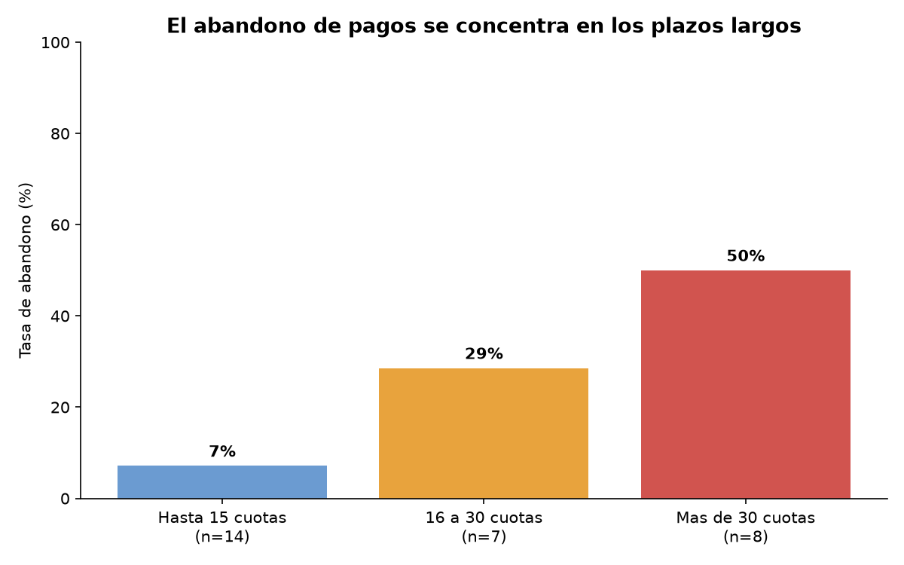

# Análisis de riesgo de incobrabilidad en ventas financiadas

Análisis de la cartera de créditos de un comercio de equipamiento que financia sus ventas en cuotas, orientado a identificar qué características de una operación anticipan que el cliente va a interrumpir los pagos.

## El problema de negocio

Comercios y prestamistas que financian a corto y mediano plazo toman la decisión de otorgar crédito por intuición y confianza personal, sin ningún criterio medible de riesgo. El resultado es capital inmovilizado en operaciones que nunca se terminan de cobrar, sin que exista registro de cuánto representa.

Este proyecto responde una pregunta concreta: ¿qué proporción de las operaciones ya cerradas quedó impaga, y cómo varía esa proporción según el plazo pactado?

## Stack tecnológico

- **Python 3** con la librería estándar (`csv`) para el procesamiento
- **matplotlib** para la visualización
- **Google Sheets** para la limpieza inicial y la anonimización del dataset

## Metodología

El proyecto sigue el ciclo **CRISP-DM** distribuido en sprints incrementales, donde cada sprint atraviesa varias fases y termina en una respuesta utilizable, en lugar de dedicar un sprint completo a cada fase.

**Sprint 1 (esta entrega):** atraviesa las seis fases del ciclo, desde la definición de la regla de negocio que distingue una operación completada de una abandonada, hasta la comunicación del hallazgo con un gráfico.

Se aplicó el criterio **JBGE** (just barely good enough) para acotar el alcance: se limpió únicamente lo necesario para responder la pregunta parcial. Quedaron fuera de esta rebanada la normalización de la frecuencia de cobro, el cálculo de márgenes y el análisis agrupado por cliente.

## Hallazgos clave

- La tasa general de abandono sobre operaciones cerradas es del **24,1%** (7 de 29 operaciones).
- El abandono **crece de forma sostenida con el plazo pactado**: 7,1% en planes de hasta 15 cuotas, 28,6% entre 16 y 30, y 50% en planes de más de 30 cuotas.
- El capital no cobrado asciende a **$11.218.900**.
- El campo "estado" del registro original **no distingue** entre una operación terminada de pagar y una abandonada, por lo que no sirve como fuente de verdad para medir riesgo.

## Cómo ejecutar el proyecto

Requisitos: Python 3.8 o superior.

1. Clonar el repositorio
2. Instalar la dependencia: `pip install matplotlib`
3. Ejecutar: `python análisis_cartera.py`

El script imprime la clasificación de operaciones y la tabla de tasas por rango de plazo, y genera el archivo `abandono_por_plazo.png` con el gráfico.

## Sobre los datos

El dataset proviene del registro propio de operaciones de un comercio de equipamiento comercial de San Juan, Argentina. Fue anonimizado antes de publicarse: se eliminaron nombres, documentos y teléfonos, y cada cliente se identifica con un código.

Son 42 operaciones, un volumen que permite un análisis exploratorio pero no conclusiones estadísticamente sólidas. Los hallazgos deben leerse como hipótesis a validar cuando crezca el volumen de operaciones registradas.
